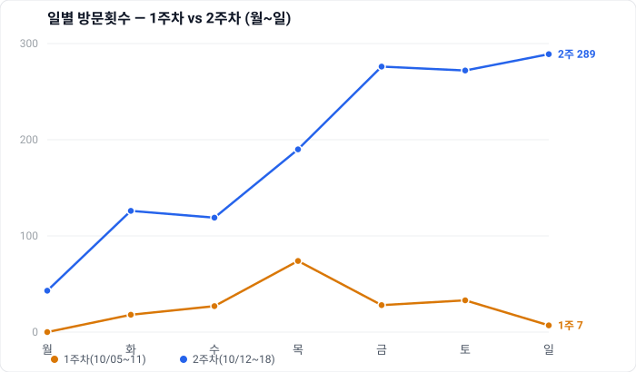

# 2주차 경제(eokonomy) 다면평가 — 표 요약판

- 주차: 1주 10/05~11(21편) / 2주 10/12~18(21편) · 벤치마크 우리·유미·쿠니네
- (설명·해석은 본편 `2026-10-19-2주차-경제-다면평가.md`)
- ※ 모든 주간 수치는 '주간 보기'로 주별 따로 수집 → **각 주 열이 그 주 순수값(누적 아님)**. 증감 = 2주 − 1주.

## ■ 제목 분석 (우리 vs 고수평균) — 형식 + 훅
고수평균 = 유미·쿠니네 2명 평균
| 항목 | 우리1주 | 고수1주 | 우리2주 | 고수2주 |
|---|---|---|---|---|
| 작은따옴표 | 10% | 72% | 100% | 89% |
| 큰따옴표 | 67% | 3% | 0% | 7% |
| 숫자 | 76% | 76% | 90% | 78% |
| 물음표끝 | 48% | 12% | 5% | 12% |
| 평균글자 | 40 | 39 | 47 | 43 |
| 훅 든 제목 | 29% | 82% | 95% | 86% |
| ① 감정·충격 | 14% | 37% | 33% | 50% |
| ② 정보격차 | 5% | 24% | 10% | 28% |
| ③ 가림 | 5% | 31% | 81% | 22% |
| ④ 긴박·시점 | 0% | 8% | 19% | 17% |
| ⑤ 전언·행동(~라는데 등) | 10% | 34% | 86% | 32% |
| 서로 다른 훅 수 | 7 | 30 | 26 | 32 |

## ■ 성과
| 지표 | 1주 | 2주 | 증감 |
|---|---|---|---|
| 발행 글 수 | 21편 | 21편 | ±0 |
| 방문횟수(주간 합계) | 187 | 1,315 | +1,128 (7.0배) |
| 방문횟수(일평균) | 27 | 188 | +161 (약 7배) |
| 일 최대 방문횟수 | 74 (10/08) | 289 (10/18) | +215 |
| 일 최소 방문횟수 | 7 (10/11) | 43 (10/12) | +36 |
| 홈피드 유입 | 68.1% | 77.6% | +9.5%p |
| 검색 비중 | 15.4% | 11.8% | -3.6%p |

## ■ 2주차 순수 성과 (발행일 기준, 조회수)
| 구분 | 2주차 기간 조회 | 비중 |
|---|---|---|
| 2주차 발행 글 | 약 1,318 | 96% |
| 1주차(이전) 글 잔존 | 약 10~48 | ≤3.5% |
| 2주차 총 | 1,366 | 100% |

(홈피드 글은 발행 직후만 반짝 → 1주차 글의 2주차 잔존 거의 없음)

## ■ 방문 효율
| 지표 | 1주 | 2주 | 증감 |
|---|---|---|---|
| 조회수(주간) | 195 | 1,366 | +1,171 (7.0배) |
| 순방문자 | 179 | 1,282 | +1,103 (7.2배) |
| 방문자당 조회수 | 1.09 | 1.07 | -0.02 |
| 방문당 조회수 | 1.04 | 1.04 | ± 0 |

## ■ 독자층 (성별·연령)
| 구간 | 1주 | 2주 | 증감 |
|---|---|---|---|
| 남 / 여 | 64 / 36 | 30 / 70 | 여 +34%p |
| 20대 이하 | 5.4% | 1.2% | -4.2%p |
| 30대 | 16.8% | 7.9% | -8.9%p |
| 40대 | 23.4% | 25.2% | +1.8%p |
| 50대 | 35.4% | 38.4% | +3.0%p |
| 60대+ | 19.2% | 27.3% | +8.1%p |

## ■ 체류·재방문
| 지표 | 1주 | 2주 | 증감 |
|---|---|---|---|
| 평균 체류 | 2:16 | 2:34 | +18초 |
| 재방문율 | 0% | 0.2% | +0.2%p |

## ■ 주제 구성
| 주제 | 1주 | 2주 |
|---|---|---|
| 증시·코인 | 21 | 7 |
| 부동산 | 0 | 6 |
| 절세·정책 | 0 | 5 |
| 금 | 0 | 3 |
